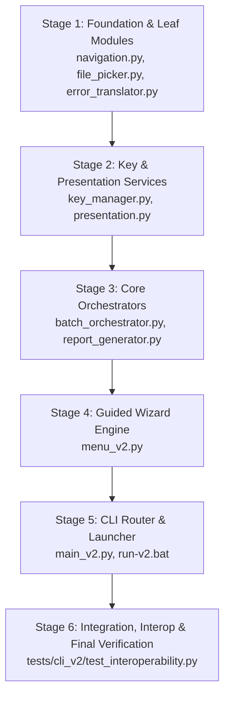
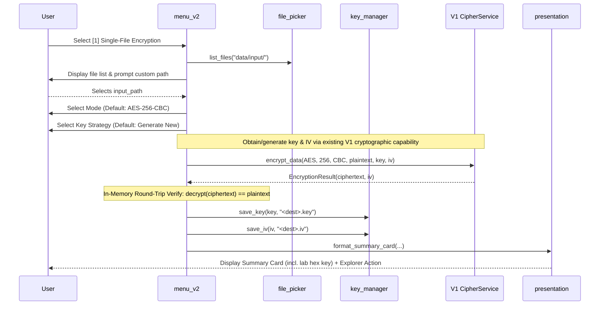

# V2 IMPLEMENTATION PLAN

**Document ID:** V2-IMPLEMENTATION-PLAN-001  
**Status:** DRAFT — V2 IMPLEMENTATION PLAN COMPLETE / PENDING INDEPENDENT REVIEW  
**Date:** 2026-09-15  
**Author:** V2 Implementation Planning Lead  
**Scope Focus:** Implementation Playbook for V2 Usability Layer (`src/cli_v2/` & `tests/cli_v2/`)  
**Target Milestone:** V2 Phase 5 (Contract-to-Execution Planning)  
**Authoritative Baseline & References:**
- [V2_CONSOLIDATED_SELECTION.md](file:///c:/Users/kodal/Cryptography_Project/docs/v2/selection/V2_CONSOLIDATED_SELECTION.md) (Frozen Selection — Commit `97a5447`)
- [V2_INTENT.md](file:///c:/Users/kodal/Cryptography_Project/docs/v2/V2_INTENT.md) (Intent Authority)
- [RESEARCH_A_MENU_UX.md](file:///c:/Users/kodal/Cryptography_Project/docs/v2/research/RESEARCH_A_MENU_UX.md) (Category A Research — Frozen)
- [RESEARCH_B_KEY_MANAGEMENT.MD](file:///c:/Users/kodal/Cryptography_Project/docs/v2/research/RESEARCH_B_KEY_MANAGEMENT.MD) (Category B Research — Frozen)
- [RESEARCH_C_BATCH_OPERATIONS.MD](file:///c:/Users/kodal/Cryptography_Project/docs/v2/research/RESEARCH_C_BATCH_OPERATIONS.MD) (Category C Research — Frozen)
- [RESEARCH_D_REPORTING.md](file:///c:/Users/kodal/Cryptography_Project/docs/v2/research/RESEARCH_D_REPORTING.md) (Category D Research — Frozen)

---

> [!IMPORTANT]
> **Implementation Boundary:** This document serves as the binding, frozen technical playbook for Phase 6 implementation. No source code changes or test creations occur during Phase 5. All designs, module contracts, sequence steps, and test obligations are derived strictly from the frozen [V2_CONSOLIDATED_SELECTION.md](file:///c:/Users/kodal/Cryptography_Project/docs/v2/selection/V2_CONSOLIDATED_SELECTION.md).

---

## 1. Executive Summary

The V2 Usability Layer extends the Cryptography Testing Lab from a developer-centric CLI into an accessible, robust, and guided laboratory environment for students, educators, and evaluators.

V1 established the verified AES cryptographic core (ECB/CBC modes, 128/192/256-bit key sizes) and service/analysis stack with 434 passing unit/integration tests, while V2 introduces no new runtime or development dependencies. However, V1 operations require manual raw hex string management, single-file invocations, and memorization of command-line flags.

V2 introduces four integrated capability categories without modifying a single line of frozen V1 code:
1. **Category A (Guided Menu UX):** A stateful, task-centric terminal wizard featuring universal step navigation (`b`ack, `c`ancel, `?` help), hybrid file selection, transparent defaults, and actionable 3-tier error diagnostics.
2. **Category B (Key Management):** Raw-hexadecimal `.key` sidecar persistence and loading, pre-execution format validation, case/whitespace normalization, and laboratory security notices.
3. **Category C (Batch Operations):** Resilient, sequential multi-file folder encryption and decryption with per-file error isolation, non-destructive file handling, skip-existing resumption, and structured CSV logging (`batch_log_*.csv`).
4. **Category D (Reporting & Analysis):** Standalone single-file HTML reports combining statistical benchmark metrics, embedded base64 Matplotlib charts (150 DPI), and comparative security diagnostics (ECB structural leakage vs. CBC diffusion), with browser auto-open integration.

### Additive Architecture & Core Invariants
- **Additive Isolation:** V2 source code resides entirely in `src/cli_v2/` and V2 tests in `tests/cli_v2/`.
- **Zero V1 Invalidation:** Existing V1 source files (`src/core/`, `src/engines/`, `src/analyzers/`, `src/utils/`, `src/cli/`) and existing V1 test files (`tests/cli/`, `tests/engines/`, `tests/utils/`, `tests/test_*.py`, `tests/__init__.py`) are read-only and immutable. The new V2 test suite is created exclusively under `tests/cli_v2/`.
- **Zero New Dependencies:** V2 introduces no new dependencies and operates within the existing project dependency environment, using standard-library facilities and existing project capabilities where required (e.g., `matplotlib`, `numpy`, `pandas`, `tabulate`).
- **Direction of Dependency:** V2 imports V1 public service interfaces (`CipherService`, `BenchmarkService`, `SecurityService`, `FileHandler`); V1 never imports V2.

---

## 2. Pre-Implementation Gate

Before any implementation work begins in Phase 6, the following objective gates must be verified:

| Gate Check | Verification Command | Expected Output / Criteria | Gate Status |
| :--- | :--- | :--- | :---: |
| **1. V1 Release Tag** | `git rev-parse "v1.0-release^{}"` | `650bc7f80ada2c4c8e61a0c29b96e9b3a65cca0a` | REQUIRED |
| **2. V1 Test Baseline** | `python -m pytest` | `434 passed, 2 skipped` | REQUIRED |
| **3. Clean Working Tree** | `git status --short` | Clean (no untracked source/test modifications) | REQUIRED |
| **4. Frozen V1 Path Integrity** | `git diff --stat src/core/ src/engines/ src/analyzers/ src/utils/ src/cli/ tests/cli/ tests/engines/ tests/utils/ tests/test_*.py tests/__init__.py` | Empty (zero modifications to existing V1 source and test files) | REQUIRED |
| **5. Selection Freeze State** | `git log -1 --oneline` | `97a5447 docs(v2): freeze consolidated selection` | REQUIRED |
| **6. Zero Unauthorized Code** | `Test-Path src/cli_v2`, `Test-Path tests/cli_v2` | `False` (clean starting state before Step 1) | REQUIRED |
| **7. Runtime & Environment** | `python --version` | Python 3.10+ (Verified on Python 3.13.0) | REQUIRED |

---

## 3. Frozen V2 Architecture & Reconciliation

### 3.1 Intent-to-Selection Architectural Reconciliation

The conceptual module layout proposed in [V2_INTENT.md](file:///c:/Users/kodal/Cryptography_Project/docs/v2/V2_INTENT.md) §9.1 is reconciled with the frozen concrete architecture in [V2_CONSOLIDATED_SELECTION.md](file:///c:/Users/kodal/Cryptography_Project/docs/v2/selection/V2_CONSOLIDATED_SELECTION.md) §5.2 as follows:

| V2_INTENT Conceptual Module | Selected V2 Module | Disposition | Architectural Justification |
| :--- | :--- | :---: | :--- |
| `main_v2.py` | `src/cli_v2/main_v2.py` | **PRESERVED** | Top-level CLI router, zero-argument menu dispatcher, and global exception boundary. |
| `menu_v2.py` | `src/cli_v2/menu_v2.py` | **PRESERVED** | Interactive menu hierarchies, primary task wizards, and supporting report/help flows. |
| `commands_v2.py` | `src/cli_v2/main_v2.py` / `src/cli_v2/menu_v2.py` | **MERGED** | CLI dispatch routed via `main_v2.py`; interactive wizard workflows orchestrated in `menu_v2.py`; eliminates unnecessary intermediate pass-through layer. |
| `key_management.py` | `src/cli_v2/key_manager.py` | **RENAMED** | Renamed for naming consistency with project utility conventions (`KeyManager`). |
| `batch_ops.py` | `src/cli_v2/batch_orchestrator.py` | **RENAMED** | Renamed to reflect orchestration of traversal, error isolation, sidecar resolution, and CSV logging. |
| `file_picker.py` | `src/cli_v2/file_picker.py` | **PRESERVED** | Hybrid file picker scanning directories and cleaning drag-and-drop quoted paths. |
| `progress.py` | `src/cli_v2/presentation.py` | **MERGED** | Merged with summary cards and formatting into unified terminal presentation module. |
| `summary.py` | `src/cli_v2/presentation.py` | **MERGED** | Merged with progress tickers and borders into unified presentation module. |
| `errors.py` | `src/cli_v2/error_translator.py` | **RENAMED** | Renamed to clarify role as structured 3-tier diagnostic translation layer. |
| `help_text.py` | `src/cli_v2/navigation.py` | **MERGED** | Contextual `?` help handlers integrated directly with step-stack navigation engine. |
| `report_generator.py` | `src/cli_v2/report_generator.py` | **PRESERVED** | Standalone HTML report compilation and in-memory base64 chart generation. |
| *(Extracted Helper)* | `src/cli_v2/navigation.py` | **EXTRACTED** | Isolated reusable step-stack engine (`b`ack, `c`ancel, prompt loop, token interception). |
| *(Windows Shortcut)* | `run-v2.bat` | **PRESERVED** | Convenience Windows batch script in project root invoking `main_v2.py %*`. |

### 3.2 Concrete Directory & File Layout

```text
src/
├── cli/                                # [Existing V1 source — READ-ONLY FOR V2]
├── core/                               # [Existing V1 source — READ-ONLY FOR V2]
├── engines/                            # [Existing V1 source — READ-ONLY FOR V2]
├── analyzers/                          # [Existing V1 source — READ-ONLY FOR V2]
├── utils/                              # [Existing V1 source — READ-ONLY FOR V2]
│
└── cli_v2/                             # [V2 USABILITY LAYER — NEW PACKAGE]
    ├── __init__.py                     # Package marker & public exports
    ├── main_v2.py                      # CLI entry point, flag parser & menu dispatch
    ├── navigation.py                   # Step stack engine (Back, Cancel, Help, Validation)
    ├── file_picker.py                  # Directory scanner & drag-and-drop path cleaner
    ├── key_manager.py                  # Key & IV persistence, validation, normalization
    ├── presentation.py                 # Summary cards, ASCII tables, \r progress tickers
    ├── error_translator.py             # 3-tier diagnostic translator & exception mapper
    ├── batch_orchestrator.py           # Multi-file batch execution, error isolation, CSV logging
    ├── report_generator.py             # Standalone HTML report builder (in-memory base64 PNG)
    └── menu_v2.py                      # Guided wizard workflows & main menu router

tests/
├── cli/                                # [Existing V1 CLI tests — READ-ONLY]
├── engines/                            # [Existing V1 engine tests — READ-ONLY]
├── utils/                              # [Existing V1 util tests — READ-ONLY]
├── test_*.py                           # [Existing V1 root test files — READ-ONLY]
├── __init__.py                         # [Existing V1 test package marker — READ-ONLY]
│
└── cli_v2/                             # [V2 TEST SUITE — NEW DIRECTORY]
    ├── __init__.py                     # Test package marker
    ├── test_navigation.py              # Navigation stack, token interception & help tests
    ├── test_file_picker.py             # File enumeration, filtering & path normalization tests
    ├── test_key_manager.py             # Key/IV sidecar save/load, validation & security notice tests
    ├── test_presentation.py            # Summary cards, progress formatting & table tests
    ├── test_error_translator.py        # 3-tier exception mapping & diagnostic output tests
    ├── test_batch_orchestrator.py      # Resilient batch execution, error isolation & CSV tests
    ├── test_report_generator.py        # HTML compilation, base64 images & XSS escaping tests
    ├── test_menu_v2.py                 # Wizard integration, round-trip & workflow tests
    ├── test_main_v2.py                 # Direct CLI routing, subcommands & --dry-run tests
    └── test_interoperability.py        # V1/V2 cross-decryption & compatibility tests

run-v2.bat                              # Windows quick-launcher in project root
```

---

## 4. File Inventory & Component Specifications

| File Path | Component Responsibility | Allowed V1 Imports | Forbidden Responsibilities | Selection References | Target Tests |
| :--- | :--- | :--- | :--- | :--- | :--- |
| `src/cli_v2/__init__.py` | Package marker exposing public entry points. | None | Crypto math, I/O | §7 | `tests/cli_v2/test_main_v2.py` |
| `src/cli_v2/navigation.py` | Reusable step-stack history, prompt loop, `b`/`c`/`?` token handling. | None | Crypto math, direct file I/O | §9.2, DSEL-002 | `tests/cli_v2/test_navigation.py` |
| `src/cli_v2/file_picker.py` | Directory listing, file size metadata, drag-and-drop quote stripping. | `src.utils.file_handler.FileHandler` | Encrypting/decrypting files | §7, §10, DSEL-015 | `tests/cli_v2/test_file_picker.py` |
| `src/cli_v2/key_manager.py` | `.key` and `.iv` sidecar save/load, raw hex validation, BOM/space normalization, lab security notice. | `src.utils.file_handler.FileHandler` | Cipher execution, modifying V1 formats | §11, §14.1, DSEL-003..005, DSEL-016..017 | `tests/cli_v2/test_key_manager.py` |
| `src/cli_v2/presentation.py` | Formatting summary cards, ASCII tables, single-line `\r` progress ticks, OS Explorer launch (`os.startfile`). | None | State mutations, crypto operations | §7, §10, §12.4, DSEL-012, DSEL-017 | `tests/cli_v2/test_presentation.py` |
| `src/cli_v2/error_translator.py` | Mapping built-in exceptions to 3-tier diagnostics (What, Why, Action), traceback in `--verbose`. | None | Custom exception class hierarchies | §16, DSEL-013 | `tests/cli_v2/test_error_translator.py` |
| `src/cli_v2/batch_orchestrator.py` | Flat directory traversal, lexical sorting, candidate filtering, per-file error isolation, `batch_log_*.csv` logging, `--dry-run` simulation. | `src.engines.cipher_service.CipherService`, `src.utils.file_handler.FileHandler` | Reimplementing AES, modifying source files | §12, §14.3, DSEL-007..009, DSEL-018..019 | `tests/cli_v2/test_batch_orchestrator.py` |
| `src/cli_v2/report_generator.py` | Standalone HTML compilation, in-memory base64 Matplotlib export (150 DPI), XSS escaping, browser auto-open dispatch. | `src.analyzers.graph_generator.GraphGenerator`, `src.utils.file_handler.FileHandler` | Metric calculation math, external web dependencies | §13, DSEL-010, DSEL-011 | `tests/cli_v2/test_report_generator.py` |
| `src/cli_v2/menu_v2.py` | Main menu navigation, primary task wizards (Workflows 1–6), supporting views (Report Viewer, Help), in-memory round-trip verify. | `src.engines.cipher_service.CipherService`, `src.engines.benchmark_service.BenchmarkService`, `src.engines.security_service.SecurityService`, `src.utils.file_handler.FileHandler` | Direct byte manipulation, modifying V1 menu | §9, §10, DSEL-001, DSEL-002, DSEL-006 | `tests/cli_v2/test_menu_v2.py` |
| `src/cli_v2/main_v2.py` | CLI argument parsing, subcommand routing (`encrypt`, `decrypt`, `batch-encrypt`, `batch-decrypt`, `benchmark`, `security`, `report`), zero-arg menu dispatch. | None (delegates to `menu_v2`, `batch_orchestrator`, `report_generator`) | Workflow business logic, crypto algorithms | §8, DSEL-001, DSEL-019 | `tests/cli_v2/test_main_v2.py` |
| `run-v2.bat` | Windows batch launcher forwarding `%*` to `main_v2.py`. | None | Business logic, crypto algorithms, path manipulations | §7.2, DSEL-014 | Manual verification |

---

## 5. Public API Contracts

The specifications below define the interface contracts for Phase 6. Each component distinguishes between:
1. **Frozen Behavioral Contract:** Required functional and external behaviors specified by the Selection.
2. **Proposed Implementation Interface:** Concrete Python classes and signatures recommended for Phase 6.
3. **Implementation Detail:** Private helper structure and internal decomposition left to Phase 6 discretion.

### 5.1 `navigation.py`

- **Frozen Behavioral Contract:** Intercepts `b`/`back` to return to prior step, `c`/`cancel` to abort current wizard and return to main menu, and `?`/`help` to display in-place contextual guidance. Re-prompts on invalid input without crashing.
- **Proposed Implementation Interface:**
```python
class StepResult:
    """Encapsulates outcome of a wizard configuration step."""
    value: Any
    action: str  # "NEXT", "BACK", "CANCEL"

class WizardStep:
    """Represents an interactive step with prompt, validation, and contextual help."""
    name: str
    prompt_text: str
    help_text: str
    validator: Callable[[str], Any]

class NavigationEngine:
    """Manages the step history stack and user input loop."""
    def __init__(self): ...
    def push_step(self, step: WizardStep) -> None: ...
    def pop_step(self) -> WizardStep | None: ...
    def prompt_step(self, step: WizardStep) -> StepResult: ...
    def prompt_choice(self, prompt: str, options: list[str], default: int = 1, help_text: str = "") -> StepResult: ...
```
- **Implementation Detail:** Exact internal data structure of the history stack and ANSI styling of prompt banners.

### 5.2 `file_picker.py`

- **Frozen Behavioral Contract:** Scans directory for candidate files, sorts results alphabetically by filename, and cleans enclosing quotes/whitespace from user-pasted drag-and-drop paths.
- **Proposed Implementation Interface:**
```python
class FilePicker:
    @staticmethod
    def clean_path(user_input: str) -> Path:
        """Strip enclosing single/double quotes and whitespace from drag-and-drop paths.""" ...
        
    @staticmethod
    def list_files(directory: Path, pattern: str = "*", exclude_extensions: set[str] = None) -> list[tuple[Path, int]]:
        """Return list of (Path, size_bytes) sorted alphabetically by filename.""" ...
```
- **Implementation Detail:** Internal helper functions for scanning directory entries and formatting byte sizes.

### 5.3 `key_manager.py`

- **Frozen Behavioral Contract:** Persists raw hexadecimal `.key` and `.iv` sidecars with trailing newline. Normalizes text by stripping UTF-8 BOM and whitespace. Validates character set `[0-9A-Fa-f]` and exact lengths (16, 24, 32 bytes for keys; 16 bytes for IV). Outputs educational security notice upon key persistence. Provides directory auto-discovery of companion sidecars.
- **Proposed Implementation Interface:**
```python
class KeyManager:
    @staticmethod
    def normalize_hex(raw_text: str) -> str:
        """Strip UTF-8 BOM, whitespace (\r, \n, \t, spaces) and return uppercase hex string.""" ...

    @staticmethod
    def validate_key_hex(hex_str: str) -> int:
        """Validate character set [0-9A-F] and length. Returns key size in bits (128, 192, 256). Raises ValueError.""" ...

    @staticmethod
    def validate_iv_hex(hex_str: str) -> bytes:
        """Validate 32 hex chars (16 bytes) IV. Returns bytes. Raises ValueError.""" ...

    @staticmethod
    def save_key(key_bytes: bytes, output_path: Path) -> Path:
        """Save raw hex key string + '\n' to <output_path>. Display lab security notice. Returns key path.""" ...

    @staticmethod
    def load_key(key_path: Path) -> tuple[bytes, int]:
        """Read and normalize .key file. Returns (key_bytes, key_size_bits). Raises FileNotFoundError, ValueError.""" ...

    @staticmethod
    def save_iv(iv_bytes: bytes, output_path: Path) -> Path:
        """Save raw hex IV string + '\n' to <output_path>. Returns IV path.""" ...

    @staticmethod
    def load_iv(iv_path: Path) -> bytes:
        """Read and normalize .iv file. Returns 16 bytes IV. Raises FileNotFoundError, ValueError.""" ...

    @staticmethod
    def auto_detect_sidecars(ciphertext_path: Path) -> tuple[Path | None, Path | None]:
        """Check for companion <path>.key and <path>.iv files in the same directory.""" ...
```
- **Implementation Detail:** File I/O staging and specific string-building helpers.

### 5.4 `presentation.py`

- **Frozen Behavioral Contract:** Formats double-line ASCII summary cards, renders single-line `\r` progress tickers without trailing newline during batch runs, formats 3-tier diagnostic boxes, and provides post-operation Windows Explorer opening via `os.startfile`. Never includes raw secrets in logs or non-interactive outputs.
- **Proposed Implementation Interface:**
```python
class Presentation:
    @staticmethod
    def format_summary_card(title: str, fields: dict[str, Any], notice: str = None) -> str:
        """Render double-line ASCII bordered summary card.""" ...

    @staticmethod
    def update_progress(current: int, total: int, filename: str, status: str = "PROCESSING") -> None:
        """Render single-line \r progress ticker without trailing newline.""" ...

    @staticmethod
    def format_diagnostic_box(what: str, why: str, actions: list[str]) -> str:
        """Render structured 3-tier error diagnostic block.""" ...

    @staticmethod
    def open_explorer(target_path: Path) -> bool:
        """Open OS file manager at target_path via os.startfile on Windows. Returns success bool.""" ...
```
- **Implementation Detail:** Terminal column width calculation and ASCII box drawing character definitions.

### 5.5 `error_translator.py`

- **Frozen Behavioral Contract:** Translates native Python exceptions into 3-tier user diagnostics (What, Why, Action) without introducing custom exception class hierarchies. Appends Python traceback when verbose mode is active.
- **Proposed Implementation Interface:**
```python
class ErrorTranslator:
    @staticmethod
    def translate(exc: Exception, context: str = "") -> tuple[str, str, list[str]]:
        """Map Python exception to (what_failed, probable_cause, list_of_actions).""" ...

    @staticmethod
    def display_error(exc: Exception, context: str = "", verbose: bool = False) -> None:
        """Print 3-tier diagnostic box to stderr; append traceback if verbose is True.""" ...
```
- **Implementation Detail:** Exact dictionary structure mapping exception types and error message substrings to user guidance.

### 5.6 `batch_orchestrator.py`

- **Frozen Behavioral Contract:** Flat directory traversal, candidate filtering with exclusion matrix (`.key`, `.iv`, `.log`, `.tmp*`, `.enc`, OS/hidden files), lexical sorting by filename, per-file error isolation (`try/except`), non-destructive overwrite safety (preserves pre-existing destination files if overwrite preparation fails), skip-existing default, unique vs shared batch key support (CBC mode generates unique random IV per file in shared mode), `batch_log_*.csv` logging with UTC ISO-8601 timestamps (`YYYY-MM-DDTHH:MM:SSZ`), and `--dry-run` simulation (zero writes, no log, no mutation).
- **Proposed Implementation Interface:**
```python
@dataclass
class BatchFileResult:
    source_file: Path
    dest_file: Path
    status: str  # "SUCCESS", "SKIPPED", "FAILED"
    size_bytes: int
    elapsed_ms: float
    error_message: str

@dataclass
class BatchSummary:
    total_files: int
    success_count: int
    skipped_count: int
    failed_count: int
    total_bytes: int
    total_time_ms: float
    results: list[BatchFileResult]
    log_file: Path | None

class BatchOrchestrator:
    def __init__(self, cipher_service: CipherService = None): ...

    def discover_files(self, source_dir: Path, is_encryption: bool = True) -> tuple[list[Path], list[Path]]:
        """Discover candidate files and excluded files in flat directory, sorted lexically.""" ...

    def preflight_check(self, candidates: list[Path], dest_dir: Path, on_conflict: str) -> dict[str, Any]:
        """Evaluate destination paths, collisions, and planned operations.""" ...

    def run_batch_encrypt(
        self,
        source_dir: Path,
        dest_dir: Path,
        algorithm: str = "AES",
        key_size: int = 256,
        mode: str = "CBC",
        shared_key: bytes | None = None,
        on_conflict: str = "skip",
        dry_run: bool = False,
        progress_callback: Callable[[int, int, str], None] = None
    ) -> BatchSummary:
        """Execute batch directory encryption with per-file error isolation and CSV logging.""" ...

    def run_batch_decrypt(
        self,
        source_dir: Path,
        dest_dir: Path,
        algorithm: str = "AES",
        key_size: int = 256,
        mode: str = "CBC",
        shared_key: bytes | None = None,
        on_conflict: str = "skip",
        dry_run: bool = False,
        progress_callback: Callable[[int, int, str], None] = None
    ) -> BatchSummary:
        """Execute batch directory decryption with per-file error isolation and CSV logging.""" ...
```
- **Implementation Detail:** Staging mechanism for temporary `.tmp_*` files during atomic replacement.

### 5.7 `report_generator.py`

- **Frozen Behavioral Contract:** Single-document HTML report saved to `results/reports/` with internal CSS, in-memory base64 Matplotlib charts at 150 DPI, strict `html.escape(quote=True)` on user strings, and `webbrowser.open()` auto-open dispatch. Decoupled from machine-readable `batch_log_*.csv` evidence files.
- **Proposed Implementation Interface:**
```python
class ReportGenerator:
    @staticmethod
    def figure_to_base64(fig: plt.Figure, dpi: int = 150) -> str:
        """Convert Matplotlib figure to in-memory Base64 PNG Data URI and call plt.close(fig).""" ...

    @staticmethod
    def build_benchmark_report(collector: MetricCollector, output_path: Path = None) -> Path:
        """Generate standalone HTML report from MetricCollector session data.""" ...

    @staticmethod
    def build_security_report(security_results: dict, output_path: Path = None) -> Path:
        """Generate standalone HTML report from SecurityService results with ECB/CBC visual.""" ...

    @staticmethod
    def open_in_browser(report_path: Path) -> bool:
        """Open generated HTML report in default browser via webbrowser.open().""" ...
```
- **Implementation Detail:** HTML template string formatting and CSS styling rules.

### 5.8 `menu_v2.py`

- **Frozen Behavioral Contract:** Task-centric 7-option main menu (1: Single-File Operations, 2: Batch Operations, 3: Benchmark Suite, 4: Security Lab, 5: View HTML Reports, 6: Help & Documentation, 7: Exit). Manages 6 primary task wizards (Workflows 1–6) and supporting views. Executes in-memory round-trip verification (`decrypt(encrypt(P)) == P`) for single-file encryption prior to summary card.
- **Proposed Implementation Interface:**
```python
class MenuV2:
    def __init__(self): ...
    def display_main_menu(self) -> None: ...
    def run_single_encrypt_wizard(self) -> None: ...
    def run_single_decrypt_wizard(self) -> None: ...
    def run_batch_encrypt_wizard(self) -> None: ...
    def run_batch_decrypt_wizard(self) -> None: ...
    def run_benchmark_wizard(self) -> None: ...
    def run_security_wizard(self) -> None: ...
    def run_report_viewer_wizard(self) -> None: ...
    def run_help_wizard(self) -> None: ...
```
- **Implementation Detail:** State variables tracking active menu level and prompt history.

### 5.9 `main_v2.py`

- **Frozen Behavioral Contract:** Top-level CLI entry point. Zero arguments launches `MenuV2` guided interactive menu. Supports non-interactive subcommands (`encrypt`, `decrypt`, `batch-encrypt`, `batch-decrypt`, `benchmark`, `security`, `report`) and shared flags (`--dry-run`, `--shared-key`, `--on-conflict`, `--no-open`, `--verbose`).
- **Proposed Implementation Interface:**
```python
def parse_args(args: list[str] = None) -> argparse.Namespace:
    """Build and parse V2 command-line arguments and subcommands.""" ...

def main(args: list[str] = None) -> int:
    """Top-level V2 entry point. Zero arguments launches MenuV2. Returns exit code.""" ...
```
- **Implementation Detail:** Argument parser setup helpers and exit code mapping.

### 5.10 `run-v2.bat` (Windows Quick-Launcher)

- **Frozen Behavioral Contract:** Project-relative Windows batch script in project root that launches `python -m src.cli_v2.main_v2` and forwards all supplied command-line arguments `%*`.
- **Proposed Implementation Approach:** The launcher script may verify that `python` is accessible before invoking the module and output a user-friendly error if Python is missing.
- **Implementation Detail:** Exact batch script branching and error message wording.

---

## 6. Implementation Sequence & Dependency Order

The implementation of Phase 6 must follow an incremental, strictly dependency-ordered sequence across 6 stages:



### Detailed Implementation Steps

| Step | Files to Create | Purpose | Prerequisites | Target Test File | Verification Checkpoint | Rollback Action |
| :---: | :--- | :--- | :--- | :--- | :--- | :--- |
| **1.1** | `src/cli_v2/__init__.py`<br>`src/cli_v2/navigation.py` | Step-stack history, token interception (`b`/`c`/`?`). | None | `tests/cli_v2/test_navigation.py` | `pytest tests/cli_v2/test_navigation.py`<br>`pytest` (434 V1 passing) | Delete `src/cli_v2/navigation.py`, `tests/cli_v2/test_navigation.py` |
| **1.2** | `src/cli_v2/file_picker.py` | Path cleaning, directory scanning, sorting. | Step 1.1 | `tests/cli_v2/test_file_picker.py` | `pytest tests/cli_v2/test_file_picker.py` | Delete `src/cli_v2/file_picker.py`, `tests/cli_v2/test_file_picker.py` |
| **1.3** | `src/cli_v2/error_translator.py` | 3-tier diagnostic translation and verbose mode. | Step 1.1 | `tests/cli_v2/test_error_translator.py` | `pytest tests/cli_v2/test_error_translator.py` | Delete `src/cli_v2/error_translator.py`, `tests/cli_v2/test_error_translator.py` |
| **2.1** | `src/cli_v2/key_manager.py` | `.key`/`.iv` save/load, normalization, validation, notices. | Stage 1 | `tests/cli_v2/test_key_manager.py` | `pytest tests/cli_v2/test_key_manager.py` | Delete `src/cli_v2/key_manager.py`, `tests/cli_v2/test_key_manager.py` |
| **2.2** | `src/cli_v2/presentation.py` | Summary cards, progress tickers, ASCII borders, Explorer launch. | Stage 1 | `tests/cli_v2/test_presentation.py` | `pytest tests/cli_v2/test_presentation.py` | Delete `src/cli_v2/presentation.py`, `tests/cli_v2/test_presentation.py` |
| **3.1** | `src/cli_v2/batch_orchestrator.py` | Multi-file batch execution, error isolation, CSV logging, dry-run. | Stage 2 | `tests/cli_v2/test_batch_orchestrator.py` | `pytest tests/cli_v2/test_batch_orchestrator.py` | Delete `src/cli_v2/batch_orchestrator.py`, `tests/cli_v2/test_batch_orchestrator.py` |
| **3.2** | `src/cli_v2/report_generator.py` | Consolidated HTML reports, 150 DPI base64 charts, browser auto-open. | Stage 2 | `tests/cli_v2/test_report_generator.py` | `pytest tests/cli_v2/test_report_generator.py` | Delete `src/cli_v2/report_generator.py`, `tests/cli_v2/test_report_generator.py` |
| **4.1** | `src/cli_v2/menu_v2.py` | 6 primary task wizards, supporting views, round-trip verify. | Stage 3 | `tests/cli_v2/test_menu_v2.py` | `pytest tests/cli_v2/test_menu_v2.py` | Delete `src/cli_v2/menu_v2.py`, `tests/cli_v2/test_menu_v2.py` |
| **5.1** | `src/cli_v2/main_v2.py`<br>`run-v2.bat` | Top-level CLI router, subcommands, zero-arg dispatch, batch launcher. | Stage 4 | `tests/cli_v2/test_main_v2.py` | `pytest tests/cli_v2/test_main_v2.py` | Delete `src/cli_v2/main_v2.py`, `run-v2.bat`, `tests/cli_v2/test_main_v2.py` |
| **6.1** | `tests/cli_v2/test_interoperability.py` | V1/V2 cross-decryption, sidecar compat, regression suite. | Stage 5 | `tests/cli_v2/test_interoperability.py` | Full `python -m pytest` (434 V1 + all V2 passing) | Delete `tests/cli_v2/test_interoperability.py` |

---

## 7. V1 Integration Boundary & Invariants

```text
┌────────────────────────────────────────────────────────┐
│                   V2 USABILITY LAYER                   │
│  src/cli_v2/ (main_v2, menu_v2, batch, report, key,..) │
└──────────────────────────┬─────────────────────────────┘
                           │ (Read-Only Imports / Method Invocations)
                           ▼
┌────────────────────────────────────────────────────────┐
│                   FROZEN V1 BASELINE                   │
│  src/core/       - AES Math, S-Box, Modes (ECB, CBC)   │
│  src/engines/    - CipherService, BenchmarkService,..  │
│  src/analyzers/  - MetricCollector, GraphGenerator,..  │
│  src/utils/      - FileHandler, Padding                │
│  src/cli/        - V1 CLI (main, commands, menu)       │
└────────────────────────────────────────────────────────┘
```

### 7.1 Allowed V1 Integration Points

These are read-only consumption points: V2 invokes the existing V1 public interfaces without modifying their implementations, signatures, semantics, or runtime state.

- `CipherService.encrypt_data(algorithm, key_size, mode, plaintext, key, iv)`
- `CipherService.decrypt_data(algorithm, key_size, mode, ciphertext, key, iv)`
- `BenchmarkService.run_performance_suite(configs, data_payloads)`
- `SecurityService.run_security_suite(configs, p1, p2, k1, k2, img, iv)`
- `GraphGenerator.generate_key_size_comparison(df)`
- `GraphGenerator.generate_mode_comparison(df)`
- `GraphGenerator.generate_throughput_vs_size(df)`
- `GraphGenerator.generate_ecb_vs_cbc_comparison(ecb_data, cbc_data, w, h)`
- `FileHandler.read_bytes(path)`, `FileHandler.write_bytes(path, data)`
- `FileHandler.read_text(path)`, `FileHandler.write_text(path, text)`
- `FileHandler.ensure_directory(path)`, `FileHandler.save_dataframe_csv(df, path)`

### 7.2 Strict V1 Invariants
- **No In-Place Modifications:** Zero edits to existing files in `src/core/`, `src/engines/`, `src/analyzers/`, `src/utils/`, `src/cli/`, `tests/cli/`, `tests/engines/`, `tests/utils/`, `tests/test_*.py`, or `tests/__init__.py`.
- **No Monkey-Patching:** V2 must not alter runtime attributes or patch methods of V1 classes.
- **No Circular Imports:** V1 modules must never import from `src.cli_v2`.

---

## 8. Key Management Implementation Plan

### 8.1 Format & Normalization Rules
- **Sidecar Extension:** `<ciphertext_path>.key` (mandatory).
- **Encoding:** Pure ASCII / UTF-8 text containing a single hexadecimal string followed by `\n`. No comment headers (`# ...`).
- **Allowed Lengths:** Exactly 32 hex chars (16 bytes $\to$ 128-bit), 48 hex chars (24 bytes $\to$ 192-bit), or 64 hex chars (32 bytes $\to$ 256-bit).
- **Normalization on Load:**
  1. Strip UTF-8 BOM (`\xef\xbb\xbf`) if present.
  2. Strip whitespace (`\r`, `\n`, `\t`, ` `).
  3. Validate characters match regex `^[0-9A-Fa-f]+$`.
  4. Validate length parity and valid byte count (16, 24, 32 bytes).
- **IV Symmetrical Handling:** Symmetrical `<ciphertext_path>.iv` containing exactly 32 hex chars (16 bytes).

### 8.2 Terminal Visibility & Secret Privacy Contract
- **Laboratory Display:** In single-file interactive encryption, the generated full hex key is displayed in the summary card to enable student/evaluator manual verification.
- **Educational Notice:** Whenever a `.key` file is written to disk, output:
  ```text
  [!] Laboratory Notice: Encryption key saved to '<path>.key'.
      Plaintext key storage is provided for laboratory and testing convenience.
      In production environments, keys must be stored in secure key vaults.
  ```
- **Secret Protection Rule:** Raw secret keys and plaintext payloads must **NEVER** be written to CSV logs (`batch_log_*.csv`), HTML reports, or diagnostic error messages.
- **Memory Residuals:** Secret zeroization is bounded by CPython immutable `bytes` limitations. V2 documents this technical reality without false security claims.

---

## 9. Single-File Workflows Implementation Plan

### 9.1 Workflow 1: Single-File Encryption


### 9.2 Workflow 2: Single-File Decryption
1. **Input Selection:** User picks ciphertext file (`data/output/` or custom path).
2. **Key Resolution:** Check `auto_detect_sidecars()`. If `<file>.key` exists, prompt `Use detected key? [Y/n]`. If missing/declined, prompt to browse `.key` or paste hex.
3. **IV Resolution (CBC Mode):** Auto-detect `<file>.iv`. If missing, prompt for hex IV.
4. **Execution:** Call V1 `CipherService.decrypt_data()`.
5. **Output Writing:** Write plaintext to destination (default: `data/decrypted/<original_name>`).
6. **Summary:** Display restored file path, size, and duration.

---

## 10. Batch Operations Implementation Plan

### 10.1 Discovery, Traversal & Ordering
- **Traversal Scope:** Flat directory iteration using `pathlib.Path.iterdir()`.
- **Lexical Sorting:** Candidates sorted alphabetically by filename (`sorted(candidates, key=lambda p: p.name.lower())`).
- **Exclusion Matrix:**
  - Companion sidecars: `*.key`, `*.iv`, `*.log`, `*.tmp*`
  - Existing ciphertexts during encryption: `*.enc`
  - OS metadata: `.DS_Store`, `Thumbs.db`, `desktop.ini`
  - Hidden dotfiles: `.*`
  - Directories, symlinks, and junction points.

### 10.2 Conflict, Resumption & Overwrite Policy
- **Default Policy:** `skip` (Skip Existing destination ciphertexts). Enables non-destructive retry and resumption of interrupted batch runs.
- **Alternative Policy:** `overwrite` (Overwrite All).

### 10.3 Atomic Replacement & Safe Overwrite Handling
- **Individual Path Atomicity:** Use `os.replace()` for individual destination replacements where supported by the OS.
- **Overwrite Failure Safety Contract:** If preparation/encryption fails for a file, newly created temporary staged artifacts (`.tmp_*`) are deleted, while pre-existing destination artifacts remain intact.
- **No Multi-File Atomicity Claim:** The filesystem does not support multi-file transactions across `.enc`, `.key`, and `.iv`. If a partial sidecar write fails after another artifact is replaced, the failure is isolated, logged as `FAILED` in `batch_log_*.csv`, and processing continues.

### 10.4 Key Strategies in Batch Operations
- **Unique-Per-File Key Mode (Default):** Fresh random key per file $\to$ `<dest>/<filename>.enc.key` and `<dest>/<filename>.enc.iv`.
- **Shared-Batch-Key Mode (`--shared-key`):** Single key for entire batch $\to$ saved once as `<dest>/batch.key`. For CBC mode, a **unique random IV** is still generated per file (`<dest>/<filename>.enc.iv`) to prevent IV reuse vulnerabilities.

### 10.5 Batch Logging Specification (`batch_log_*.csv`)
- **Location:** `<output_dir>/batch_log_YYYYMMDD_HHMMSS.csv`
- **Schema:** `timestamp,source_file,dest_file,status,size_bytes,elapsed_ms,error_message`
- **Timestamp Standard:** Strict UTC ISO-8601 (`YYYY-MM-DDTHH:MM:SSZ`).
- **Secret Protection:** Zero raw keys or plaintext in CSV.

---

## 11. Three Execution Semantics Plan

The implementation must maintain a strict, testable distinction between the 3 execution modes:

```text
1. Interactive V2 Menu Mode:
   pre-flight discovery  ──►  display preview  ──►  explicit user confirmation  ──►  execute

2. Direct V2 CLI Mode:
   pre-flight discovery  ──►  display plan info ──►  execute without interactive confirmation

3. Dry-Run Simulation Mode (--dry-run):
   pre-flight discovery  ──►  display plan to stdout ──►  exit (ZERO writes, NO log, NO files)
```

| Dimension | Interactive Menu Mode | Direct CLI Mode | Dry-Run Simulation Mode (`--dry-run`) |
| :--- | :--- | :--- | :--- |
| **Invocation** | `python -m src.cli_v2.main_v2` (or `menu`) | `python -m src.cli_v2.main_v2 [cmd] [opts]` | `python -m src.cli_v2.main_v2 [cmd] --dry-run` |
| **Interactive Prompt** | Yes (step-by-step wizard) | No (non-interactive, scriptable) | No |
| **Pre-Flight Preview** | Displayed in wizard | Displayed to stdout | Displayed to stdout |
| **User Confirmation** | Required (`[Y/n]` prompt) | None (executes immediately) | None (exits after preview) |
| **File Mutation** | Reads source, writes destination | Reads source, writes destination | **Zero writes** (source & dest untouched) |
| **Sidecar Creation** | Generates `.key` and `.iv` | Generates `.key` and `.iv` | **Zero sidecars created** |
| **Batch CSV Log** | Written on completion | Written on completion | **No batch log created** |

---

## 12. Reporting Implementation Plan

### 12.1 Standalone HTML Report Architecture
- **Single-Document Artifact:** `results/reports/cryptography_report_YYYYMMDD_HHMMSS.html` containing all HTML, CSS, and base64 Matplotlib charts embedded inline.
- **Zero External Dependencies:** No external CDNs, Google Fonts, or remote JavaScript links.
- **Chart Rendering:** Matplotlib figures converted in-memory via `io.BytesIO()`, encoded as base64 PNG Data URIs (`data:image/png;base64,...`) at **150 DPI**, and closed immediately via `plt.close(fig)`.
- **Separation from Batch Logs:** HTML report is a standalone presentation artifact. Batch CSV logs (`data/output/batch_log_*.csv`) remain distinct machine-readable evidence files and are not embedded inside the HTML.
- **XSS Sanitization:** All dynamic strings, paths, and error messages injected into HTML templates are escaped via `html.escape(quote=True)`.

### 12.2 Report Sections & Metrics
1. **Header & Metadata:** Generation timestamp (UTC ISO-8601), Python version, platform, schema version (`data-report-version="2.0"`).
2. **Executive Summary:** Peak throughput (MB/s), fastest key size/mode, security pass summary.
3. **Performance Benchmarks:** Throughput MB/s, latency mean $\pm$ std dev, Tukey outlier fences, embedded charts (Key Size Comparison, Mode Comparison, Throughput vs Payload).
4. **Security Analysis:** Avalanche effect percentage bar, key sensitivity analysis, side-by-side ECB pattern leakage vs CBC diffusion bitmap visualization. *(Note: Shannon entropy is excluded, matching V1 `SecurityEvaluator` capabilities).*
5. **Experimental Methodology:** 5 warmup iterations, 30 sample iterations, $1.5 \times \text{IQR}$ fences, binary MB ($1,048,576\text{ bytes}$).

### 12.3 Browser Auto-Open (D4) vs Explorer Launcher (A4)
- **D4 (Browser Report Open):** Uses `webbrowser.open(report_path.resolve().as_uri())`. Prompted in interactive menu mode (`[Y/n]`); enabled by default in CLI mode (suppressible via `--no-open`).
- **A4 (Explorer Directory Open):** Uses `os.startfile(target_dir)` on Windows. Offered as an interactive post-operation menu choice on summary cards.

---

## 13. Error Handling & 3-Tier Diagnostics Plan

All runtime errors are translated into structured 3-tier diagnostics using native Python exceptions:

```text
[!] Operation Failed: <Short Title>
------------------------------------------------------------
What Failed    : <Plain-English description of immediate failure>
Probable Cause : <Root cause explanation (key mismatch, corrupt padding, locked file)>
Action Steps   : 1. <Step one>
                 2. <Step two>
```

### Exception Mapping Matrix

| Failure Class | Underlying Exception | What Failed | Probable Cause | Action Steps |
| :--- | :--- | :--- | :--- | :--- |
| **Padding / Corrupt Ciphertext** | `ValueError` ("Invalid padding...") | Decryption failed. | Wrong key selected, incorrect cipher mode, or corrupt ciphertext payload. | 1. Check that the companion `.key` matches the ciphertext.<br>2. For CBC mode, ensure the matching `.iv` is present.<br>3. Verify the correct mode (CBC vs ECB) was selected. |
| **Invalid Key Format** | `ValueError` ("Invalid hex...") | Key loading failed. | The `.key` file contains non-hexadecimal characters or an invalid length. | 1. Ensure the key contains only hex digits `[0-9a-fA-F]`.<br>2. Verify length is exactly 32, 48, or 64 hex characters (128/192/256 bits). |
| **Missing Companion File** | `FileNotFoundError` | Required file not found. | Specified file path does not exist or companion `.iv` sidecar is missing. | 1. Verify the file path is correct.<br>2. If decrypting CBC, ensure `<file>.iv` exists in the same folder. |
| **Permission / OS Lock** | `PermissionError` | Cannot read or write file. | File is locked by another process or destination directory is read-only. | 1. Close any application currently accessing the file.<br>2. Check folder write permissions or select another output directory. |
| **Disk Space / OS Error** | `OSError` | I/O operation failed. | Disk full or filesystem path limit exceeded. | 1. Free up disk space on the target drive.<br>2. Check for invalid path characters. |

---

## 14. Comprehensive Test Plan

Tests in `tests/cli_v2/` will utilize `pytest`, `tmp_path`, `monkeypatch`, and `capsys` to achieve comprehensive coverage without modifying existing V1 tests. Test obligations are derived directly from the functional requirements of the Selection rather than an arbitrary target number.

```text
tests/cli_v2/
├── test_navigation.py          (Step stack, Back, Cancel, ?, invalid input retry)
├── test_file_picker.py         (Scanning, filtering, quotes stripping, sorting)
├── test_key_manager.py         (.key/.iv save/load, validation, BOM/whitespace, notices)
├── test_presentation.py        (Summary cards, \r progress ticks, ASCII tables, Explorer mock)
├── test_error_translator.py    (Exception mapping to 3-tier diagnostics, --verbose traceback)
├── test_batch_orchestrator.py  (Multi-file encrypt/decrypt, skip/overwrite, isolation, dry-run)
├── test_report_generator.py    (HTML builder, base64 images, 150 DPI, XSS escape, browser mock)
├── test_menu_v2.py             (6 primary wizards, supporting views, in-memory round-trip verify)
├── test_main_v2.py             (CLI routing, subcommands, zero-arg default, flags)
└── test_interoperability.py    (V1 -> V2 and V2 -> V1 cross-decryption, sidecar compat)
```

### 14.1 Module-by-Module Test Matrix

| Test Module | Target Tested Component | Normal Case Tests | Boundary & Edge Cases | Failure & Security Cases |
| :--- | :--- | :--- | :--- | :--- |
| `test_navigation.py` | `NavigationEngine` | Pushing/popping steps, valid input progression, choice selection. | Case-insensitive `B`/`b`, `C`/`c`, `?`/`help`, empty inputs. | Invalid option retry loop, stack underflow prevention. |
| `test_file_picker.py` | `FilePicker` | Listing directory, sorting by name, custom path entry. | Drag-and-drop double quotes (`"path"`), single quotes (`'path'`), trailing spaces. | Non-existent paths, empty folders, permission-denied directories. |
| `test_key_manager.py` | `KeyManager` | Saving/loading 128/192/256-bit `.key` and 128-bit `.iv`. | Stripping UTF-8 BOM, leading/trailing whitespace, mixed case hex. | Non-hex characters, odd length strings, invalid lengths (e.g. 15 bytes), missing sidecars. |
| `test_presentation.py` | `Presentation` | Summary cards formatting, progress ticker string formatting. | 0 files total, single file, large file sizes ($>1\text{GB}$ formatting). | Suppressing secrets from formatted strings, Explorer dispatch error handling. |
| `test_error_translator.py` | `ErrorTranslator` | Translating `ValueError`, `FileNotFoundError`, `PermissionError`. | Nested exceptions, unknown exception types fallback. | Verbose mode traceback formatting, ensuring secrets not in error output. |
| `test_batch_orchestrator.py` | `BatchOrchestrator` | Multi-file directory encrypt & decrypt, unique per-file keys, `--shared-key`. | Empty folders, non-flat subfolder exclusion, sidecar exclusion (`.key`, `.iv`, `.log`, `.tmp*`), lexical ordering. | Per-file error isolation (corrupt file doesn't stop batch), skip existing resumption, overwrite safety, `--dry-run` zero-write guarantee. |
| `test_report_generator.py` | `ReportGenerator` | Compiling benchmark and security HTML reports with inline base64 charts. | Empty metric sets, 150 DPI figure export, `@media print` CSS rules. | Hostile input strings with `<script>` tags (asserting `html.escape`), browser launch failure fallback. |
| `test_menu_v2.py` | `MenuV2` | End-to-end wizard executions (Workflows 1–6 and supporting views). | Step backtracking (`b`) preserving entered state, cancelling (`c`) cleaning temp files. | In-memory round-trip verification assertion failure handling. |
| `test_main_v2.py` | `main_v2.py` | Zero-arg launches menu, subcommands execute directly (`encrypt`, `batch-encrypt`, etc.). | Flag parsing: `--dry-run`, `--shared-key`, `--on-conflict`, `--no-open`, `--verbose`. | Invalid subcommands, missing required CLI arguments. |
| `test_interoperability.py` | Cross-System | Encrypt via V2 $\to$ Decrypt via V1 CLI; Encrypt via V1 $\to$ Decrypt via V2. | Supplying V2 `.key` file content to V1 `--key` argument; symmetrical `.iv` loading. | Mismatched key sizes, corrupt IV compatibility. |

---

## 15. Manual Smoke-Test Matrix

| Test ID | Category | Scenario | Execution Command / Steps | Expected Observable Behavior |
| :---: | :--- | :--- | :--- | :--- |
| **ST-01** | Navigation | Zero-arg menu launch | Run `python -m src.cli_v2.main_v2` | Displays 7-option main menu. |
| **ST-02** | Navigation | Step Backtracking | In single encrypt wizard, enter path, proceed to mode, enter `b` | Returns to path selection with previous path remembered. |
| **ST-03** | Navigation | Step Cancellation | In any wizard, enter `c` | Aborts wizard immediately and cleanly returns to main menu. |
| **ST-04** | Navigation | Contextual Help | At any wizard prompt, enter `?` | Displays in-place educational explanation and re-prompts. |
| **ST-05** | Single-File | Guided Encryption | Encrypt sample file in `data/input/` with AES-256-CBC | In-memory round-trip succeeds; creates `.enc`, `.key`, `.iv`; displays summary card with lab hex key. |
| **ST-06** | Single-File | Sidecar Auto-Discovery | Decrypt the `.enc` file created in ST-05 | Auto-detects matching `.key` and `.iv`; prompts `[Y/n]` confirmation; decrypts cleanly. |
| **ST-07** | Single-File | Explorer Launcher | On ST-05 summary card, select action to open output folder | Opens Windows Explorer focused on `data/output/`. |
| **ST-08** | Batch | Folder Encryption | Run batch encrypt on `data/input/` (default unique keys) | Shows pre-flight preview; requires `[Y/n]` confirmation; displays `\r` progress; writes `batch_log_*.csv`. |
| **ST-09** | Batch | Skip Existing Resumption | Re-run batch encrypt on same folder with `skip` conflict policy | Discovers existing files, tallies all as `SKIPPED`, writes zero duplicate ciphertexts. |
| **ST-10** | Batch | Shared Key Mode | Run batch encrypt with `--shared-key` | Creates single `<dest>/batch.key` and individual `<filename>.enc.iv` sidecars. |
| **ST-11** | Batch | Dry-Run Simulation | Run `python -m src.cli_v2.main_v2 batch-encrypt --dry-run` | Prints planned operations to stdout; creates zero files, zero sidecars, zero logs. |
| **ST-12** | Batch | Error Isolation | Place unreadable/locked file in batch directory and execute | Unreadable file logged as `FAILED` in CSV; remaining files processed successfully. |
| **ST-13** | Reporting | HTML Benchmark Report | Run Benchmark Wizard & select auto-open `Y` | Launches default browser displaying offline HTML report with embedded 150 DPI Matplotlib charts. |
| **ST-14** | Reporting | Security Report | Run Security Wizard (Avalanche + ECB/CBC Visual) | Generates HTML report with side-by-side bitmap visualization; auto-opens in browser. |
| **ST-15** | Launcher | Windows Batch Shortcut | Double-click `run-v2.bat` in project root | Opens terminal and launches V2 interactive guided menu. |
| **ST-16** | Interop | V2 Encrypt $\to$ V1 Decrypt | Encrypt file in V2; copy hex from `.key` $\to$ run V1 `src.cli.main decrypt --key <hex>` | V1 decrypts ciphertext to original plaintext. |

---

## 16. Verification Checkpoints & Gating Rules

During Phase 6 execution, the developer must run these verification commands at every stage checkpoint:

```powershell
# 1. Run newly created V2 tests
python -m pytest tests/cli_v2/

# 2. Run complete regression suite (V1 + V2)
python -m pytest

# 3. Assert zero modifications to frozen V1 directories and tests
git diff --stat src/core/ src/engines/ src/analyzers/ src/utils/ src/cli/ tests/cli/ tests/engines/ tests/utils/ tests/test_*.py tests/__init__.py

# 4. Check git status for unintended files
git status --short
```

### Checkpoint Criteria
- **Green Baseline:** All existing 434 V1 tests must pass at every stage.
- **Zero V1 Diff:** `git diff` against frozen V1 source and test paths must return completely empty.
- **Immediate Rollback:** If any V1 test fails or any V1 file is touched, stop immediately and revert the increment.

---

## 17. Objective Acceptance Criteria Traceability

| ID | Selection Acceptance Criterion ([V2_CONSOLIDATED_SELECTION.md](file:///c:/Users/kodal/Cryptography_Project/docs/v2/selection/V2_CONSOLIDATED_SELECTION.md) §19) | Implementation Location | Test Verification | Observable Evidence |
| :-: | :--- | :--- | :--- | :--- |
| **AC-1** | `git diff --stat` against frozen V1 source paths (`src/core/`, `src/engines/`, `src/analyzers/`, `src/utils/`, `src/cli/`) and existing V1 test paths (`tests/cli/`, `tests/engines/`, `tests/utils/`, `tests/test_*.py`, `tests/__init__.py`) returns empty; creation and modification of `tests/cli_v2/` is explicitly permitted. | `src/core/`, `src/engines/`, `src/analyzers/`, `src/utils/`, `src/cli/`, `tests/` | Checkpoint verification command | `git diff --stat` returns empty string for V1 paths. |
| **AC-2** | Frozen V1 baseline remains 434 passed / 2 skipped, and all newly added V2 tests in `tests/cli_v2/` pass with no unexpected failures or errors. | `tests/cli_v2/` | `python -m pytest` | Pytest summary: `434 + N passed, 2 skipped`. |
| **AC-3** | `python -m src.cli_v2.main_v2` launches guided interactive menu cleanly without arguments. | `src/cli_v2/main_v2.py`, `src/cli_v2/menu_v2.py` | `test_main_v2.py`, Manual ST-01 | Main menu renders 7 options and prompt loop. |
| **AC-4** | Single-file encryption creates valid ciphertext and symmetrical `.key` / `.iv` sidecars. | `src/cli_v2/key_manager.py`, `src/cli_v2/menu_v2.py` | `test_key_manager.py`, `test_menu_v2.py` | Output directory contains `<file>.enc`, `<file>.enc.key`, `<file>.enc.iv`. |
| **AC-5** | Cryptographic interoperability: V2 ciphertext decryptable via V1 CLI using `.key` hex content, and vice versa. | `src/cli_v2/key_manager.py` | `test_interoperability.py`, Manual ST-16 | Decrypted bytes match original input bytes. |
| **AC-6** | Batch operations process folders, isolate errors, skip existing files, and write valid CSV logs. | `src/cli_v2/batch_orchestrator.py` | `test_batch_orchestrator.py`, Manual ST-08, ST-12 | `batch_log_*.csv` written with UTC ISO-8601 timestamps and valid row schema. |
| **AC-7** | Generated HTML reports open in browser, render tables and base64 graphs offline, and contain zero raw secrets. | `src/cli_v2/report_generator.py` | `test_report_generator.py`, Manual ST-13, ST-14 | HTML report renders styled tables and Matplotlib PNGs without external network requests. |

---

## 18. Contract Traceability Matrix (DSEL-001 through DSEL-019)

| Decision ID | Summary of Frozen Project Selection | Implementing Module(s) | Verification Test(s) | Target AC |
| :--- | :--- | :--- | :--- | :---: |
| **DSEL-001** | Standalone V2 entry point (`main_v2.py`), zero-arg menu launch, non-interactive subcommands. | `src/cli_v2/main_v2.py` | `test_main_v2.py` | AC-3 |
| **DSEL-002** | Stack-based stateful wizard supporting `b`ack, `c`ancel, and `?` help tokens. | `src/cli_v2/navigation.py`, `menu_v2.py` | `test_navigation.py`, `test_menu_v2.py` | AC-3 |
| **DSEL-003** | Pure raw hex text format for `.key` sidecar without `#` comments. | `src/cli_v2/key_manager.py` | `test_key_manager.py` | AC-4, AC-5 |
| **DSEL-004** | Symmetrical sidecar naming (`<dest>.key`, `<dest>.iv`) and directory auto-discovery. | `src/cli_v2/key_manager.py` | `test_key_manager.py`, `test_menu_v2.py` | AC-4 |
| **DSEL-005** | Permissive whitespace/BOM normalization with strict hex length validation (16/24/32 B). | `src/cli_v2/key_manager.py` | `test_key_manager.py` | AC-4, AC-5 |
| **DSEL-006** | In-memory round-trip verification for single-file encryption prior to summary card. | `src/cli_v2/menu_v2.py` | `test_menu_v2.py` | AC-4 |
| **DSEL-007** | Flat directory traversal with lexical sorting and automatic exclusion matrix. | `src/cli_v2/batch_orchestrator.py` | `test_batch_orchestrator.py` | AC-6 |
| **DSEL-008** | Skip Existing default batch overwrite policy with `--on-conflict overwrite` override. | `src/cli_v2/batch_orchestrator.py` | `test_batch_orchestrator.py` | AC-6 |
| **DSEL-009** | Per-file error isolation, safe temp file cleanup, and `batch_log_*.csv` logging. | `src/cli_v2/batch_orchestrator.py` | `test_batch_orchestrator.py` | AC-6 |
| **DSEL-010** | Single standalone HTML report with inline CSS and base64 PNG charts (150 DPI). | `src/cli_v2/report_generator.py` | `test_report_generator.py` | AC-7 |
| **DSEL-011** | HTML report browser auto-open (`[Y/n]` prompt in menu, default in CLI, `--no-open` flag). | `src/cli_v2/report_generator.py` | `test_report_generator.py` | AC-7 |
| **DSEL-012** | Post-operation interactive menu action to open output directory in OS Explorer (A4). | `src/cli_v2/presentation.py` | `test_presentation.py` | AC-3 |
| **DSEL-013** | Dedicated `error_translator.py` mapping exceptions to 3-tier user diagnostics. | `src/cli_v2/error_translator.py` | `test_error_translator.py` | AC-2 |
| **DSEL-014** | Windows quick launcher batch script (`run-v2.bat`) forwarding `%*` to `main_v2.py`. | `run-v2.bat` | Manual ST-15 | AC-3 |
| **DSEL-015** | Auto-create workspace directories (`data/output/`, `results/reports/`) via `FileHandler`. | `src/cli_v2/file_picker.py`, `batch_orchestrator.py` | `test_file_picker.py` | AC-4, AC-6 |
| **DSEL-016** | Strict stateless execution per wizard run with zero global in-memory session key caching. | `src/cli_v2/menu_v2.py` | `test_menu_v2.py` | AC-4 |
| **DSEL-017** | Full hex key displayed in summary card for lab verification with educational notice. | `src/cli_v2/presentation.py`, `key_manager.py` | `test_presentation.py` | AC-4 |
| **DSEL-018** | Default unique keys in batch; opt-in shared batch key (`batch.key`) with unique random IVs. | `src/cli_v2/batch_orchestrator.py` | `test_batch_orchestrator.py` | AC-6 |
| **DSEL-019** | Pre-flight discovery preview and confirmation in menu; direct CLI non-interactive; `--dry-run` simulation. | `src/cli_v2/batch_orchestrator.py`, `main_v2.py` | `test_batch_orchestrator.py`, `test_main_v2.py` | AC-6 |

---

## 19. Research-to-Implementation Traceability Matrix

| V2 Intent Requirement | Research Source | Selection Decision | Implementation Module(s) | Implementation Task Summary |
| :--- | :--- | :--- | :--- | :--- |
| **A1: File Picker** | Report A §14, A-04 | DSEL-002, DSEL-015 | `src/cli_v2/file_picker.py` | Implement directory listing and drag-and-drop quote-stripping parser. |
| **A2: Output Prompts** | Report A §6, A-03, A-05 | DSEL-004, DSEL-015 | `src/cli_v2/menu_v2.py` | Implement default output path resolution and auto-create directory checks. |
| **A3: Round-Trip Verify** | Report A §12, A-06 | DSEL-006 | `src/cli_v2/menu_v2.py` | Add in-memory decryption assertion immediately following single-file encryption. |
| **A4: Explorer Launcher** | Report A §19, A-10 | DSEL-012 | `src/cli_v2/presentation.py` | Implement `os.startfile` wrapper as an interactive summary card menu option. |
| **A5: Summary Cards** | Report A §12, A-07 | DSEL-002, DSEL-017 | `src/cli_v2/presentation.py` | Build double-line ASCII summary box with timing, size, and lab hex key display. |
| **A6: Error Diagnostics** | Report A §9, A-08 | DSEL-013 | `src/cli_v2/error_translator.py` | Implement What/Why/Action 3-tier translation for standard Python exceptions. |
| **A7: In-App Help** | Report A §10, A-09 | DSEL-013 | `src/cli_v2/navigation.py` | Intercept `?` tokens and display contextual guidance during prompt loops. |
| **B1: Key/IV Persistence** | Report B §2, B-01, B-02 | DSEL-003, DSEL-004 | `src/cli_v2/key_manager.py` | Implement `.key` and `.iv` sidecar text writing with trailing newline. |
| **B2: Key Loading** | Report B §19, B-04, B-08 | DSEL-005, DSEL-016 | `src/cli_v2/key_manager.py` | Implement BOM and whitespace normalization with sidecar auto-detection. |
| **B3: Key Validation** | Report B §19, B-03, B-07 | DSEL-005 | `src/cli_v2/key_manager.py` | Implement hex character set validation and 128/192/256-bit size derivation. |
| **B4: Security Notices** | Report B §13, B-05 | DSEL-003, DSEL-017 | `src/cli_v2/presentation.py` | Display non-blocking laboratory security banner whenever `.key` is written. |
| **C1: Batch Encrypt** | Report C §4, C-01..C-05 | DSEL-007, 008, 018 | `src/cli_v2/batch_orchestrator.py` | Implement sequential flat-directory iteration with unique or shared keys. |
| **C2: Batch Decrypt** | Report C §5, C-06..C-08 | DSEL-008, 009, 018 | `src/cli_v2/batch_orchestrator.py` | Implement sequential decryption with sidecar auto-discovery and error isolation. |
| **C3: Accounting/Status** | Report C §11, C-09, C-12 | DSEL-009, DSEL-019 | `src/cli_v2/presentation.py` | Implement single-line `\r` progress ticker and post-batch accounting table. |
| **C4: Resilient Logging** | Report C §12, C-10, C-11 | DSEL-009 | `src/cli_v2/batch_orchestrator.py` | Implement `batch_log_*.csv` logging with UTC ISO-8601 timestamps and error isolation. |
| **D1: Benchmark Reports** | Report D §4, D-05, D-09 | DSEL-010 | `src/cli_v2/report_generator.py` | Assemble performance tables and Tukey stats into consolidated HTML template. |
| **D2: Standalone HTML** | Report D §6, D-01..D-04 | DSEL-010 | `src/cli_v2/report_generator.py` | Build single HTML document with internal CSS and base64 Matplotlib PNGs (150 DPI). |
| **D3: Security Visuals** | Report D §8, D-08, D-12 | DSEL-010 | `src/cli_v2/report_generator.py` | Render avalanche percentage bar and side-by-side ECB/CBC bitmap leakage charts. |
| **D4: Auto-Open Browser** | Report D §9, D-07, D-14 | DSEL-011 | `src/cli_v2/report_generator.py` | Implement `webbrowser.open()` dispatch with `--no-open` override support. |

---

## 20. Risk Register & Mitigations

| Risk ID | Risk Description | Severity | Detection Mechanism | Mitigation Strategy | Verification |
| :---: | :--- | :---: | :--- | :--- | :--- |
| **R-01** | Accidental modification of frozen V1 source or test files. | **CRITICAL** | `git diff --stat src/core/ src/engines/ ... tests/cli/ ...` | V2 imports V1 as read-only library. Automated git diff check at every stage checkpoint. | Checkpoint diff returns empty string. |
| **R-02** | Accidental secret leakage in logs or HTML reports. | **HIGH** | Grep / regex audit on generated CSV and HTML files. | Explicit sanitization filters in `BatchOrchestrator` and `ReportGenerator`. Terminal display only. | Dedicated test asserting key hex absent from CSV and HTML outputs. |
| **R-03** | Partial artifact destruction during failed overwrite. | **HIGH** | Automated test simulating write failure mid-batch. | Failed overwrite cleans newly staged temporary files without touching pre-existing destination artifacts. | Test `test_overwrite_failure_preserves_existing()`. |
| **R-04** | Windows drag-and-drop path formatting issues. | **MEDIUM** | Test path cleaning with enclosed quotes. | `FilePicker.clean_path()` strips `'`, `"`, and whitespace before `pathlib.Path` conversion. | Unit tests in `test_file_picker.py`. |
| **R-05** | HTML report XSS via hostile file names. | **MEDIUM** | Unit test with payload `<script>alert(1)</script>.txt`. | Strict `html.escape(quote=True)` on all dynamic template variables. | Test `test_html_escaping_on_hostile_filenames()`. |
| **R-06** | Browser auto-open failure in headless / CI environments. | **LOW** | Headless CLI execution test. | Catch `Exception` on `webbrowser.open()` and provide `--no-open` flag to suppress launch. | Headless pytest run with mock. |
| **R-07** | Regression in V1 cryptographic baseline. | **CRITICAL** | `python -m pytest` | Run full 434-test suite after every file change. | Baseline remains 434 passed / 2 skipped. |

---

## 21. Rollback Strategy

Because V2 is strictly additive, rollback of any stage or increment is completely isolated from V1:
1. **Per-Stage Isolation:** If a stage fails verification or introduces a regression, delete only the specific `src/cli_v2/<file>.py` and `tests/cli_v2/<test>.py` files created in that stage.
2. **Zero V1 Rollback Overhead:** V1 is never modified, meaning no git resets, patches, or cherry-picks are ever needed on V1 directories.
3. **Clean Baseline Guarantee:** Running `python -m pytest` after deleting a failed V2 increment immediately restores the verified 434-test green baseline.

---

## 22. Definition of Done (DoD)

Phase 6 implementation is considered complete and ready for independent verification when:
1. All 10 V2 source and launcher files (`src/cli_v2/*.py`, `run-v2.bat`) are fully implemented per contracts.
2. All newly implemented V2 test files (`tests/cli_v2/*.py`) pass with no unexpected failures or errors.
3. The frozen V1 test baseline remains exactly `434 passed, 2 skipped` with zero regressions.
4. `git diff --stat src/core/ src/engines/ src/analyzers/ src/utils/ src/cli/ tests/cli/ tests/engines/ tests/utils/ tests/test_*.py tests/__init__.py` returns completely empty.
5. Zero new runtime or development dependencies added to `requirements.txt`.
6. All 16 manual smoke tests in §15 pass and exhibit expected observable behaviors.
7. V1/V2 cryptographic interoperability is verified in automated integration tests.
8. Independent forensic implementation audit issues a formal `PASS` verdict.

---

## 23. Commit & Implementation Checkpoint Strategy

Phase 6 should be executed in discrete, incremental commits following conventional commits syntax:

```text
Commit 1: feat(v2): implement navigation engine and step-stack test harness
Commit 2: feat(v2): implement file picker and path normalization utilities
Commit 3: feat(v2): implement 3-tier error translation and diagnostic output
Commit 4: feat(v2): implement key manager and sidecar persistence services
Commit 5: feat(v2): implement terminal presentation and summary card formatters
Commit 6: feat(v2): implement resilient batch orchestrator and CSV logging
Commit 7: feat(v2): implement standalone HTML report generator with inline base64 charts
Commit 8: feat(v2): implement guided wizard workflows and in-memory round-trip verification
Commit 9: feat(v2): implement CLI entry point router, subcommands, and run-v2.bat launcher
Commit 10: test(v2): add cross-version cryptographic interoperability test suite
```
*(Note: No commits are created during Phase 5).*

---

## 24. Implementation-Plan Self-Audit

An independent self-audit was performed across all sections of this plan:

- [x] **Contract Completeness:** Full scope of Categories A, B, C, and D is represented without omissions or unapproved additions.
- [x] **Architecture Reconciliation:** Explicitly reconciles V2_INTENT conceptual layout with frozen V2 Selection layout.
- [x] **V1 Protection:** Verified strict one-way dependency direction (`cli_v2` $\to$ `engines`/`utils`/`core`) with explicit V1 test path manifest.
- [x] **Batch Safety:** Preserves overwrite safety (no blind deletion of existing files on preparation failure), per-file error isolation, and avoids false multi-file transaction claims.
- [x] **Execution Semantics:** Cleanly distinguishes Interactive Menu, Direct CLI, and `--dry-run` modes.
- [x] **Key Management:** Explicitly defines raw hex `.key`/`.iv` contracts, normalization, lab visibility notice, and secret exclusion from logs/reports.
- [x] **Reporting:** Standalone single-file HTML report with 150 DPI base64 Matplotlib charts, inline CSS, XSS escaping, and separate `batch_log_*.csv`.
- [x] **Language Integrity:** Verified absence of unsupported hyperbolic claims; all absolute words reflect verified invariants or bounded technical definitions.
- [x] **Numerical Precision:** All numbers trace directly to frozen selection (434 tests, 2 skipped, 150 DPI, 53 recommendations, 35 open decisions, 19 DSELs).

---

## 25. Final Status & Next Steps

```text
STATUS:
DRAFT — V2 IMPLEMENTATION PLAN COMPLETE / PENDING INDEPENDENT REVIEW
```

**Next Step:** Independent forensic review of `docs/v2/implementation/V2_IMPLEMENTATION_PLAN.md`. No implementation code or test files may be created until this implementation plan is independently verified and frozen.
